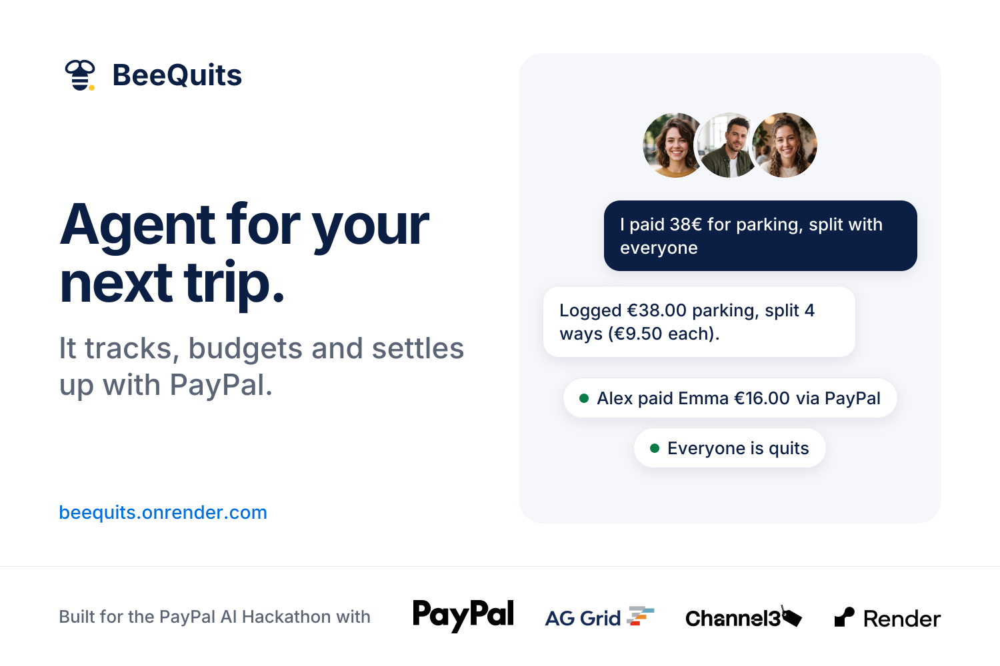

# BeeQuits



**An AI agent for your next trip. It tracks, budgets and settles up with PayPal.**

Chat your trip costs to the agent. It logs and splits them, keeps the group budget, finds gear, and at the end works out the fewest payments needed. Everyone pays their friends directly with PayPal; money never goes through the app.

**Live demo:** [beequits.onrender.com](https://beequits.onrender.com) (PayPal sandbox, no sign-up)

Built for the [PayPal AI Hackathon](https://paypalaihackathon.devpost.com/).

## Built with
- **PayPal:** Orders API v2, JS SDK buttons, Log In with PayPal, webhooks (sandbox)
- **Claude Sonnet:** the agent, using tools for every change to the ledger
- **Channel3:** product search for trip gear
- **AG Grid (AG Studio):** the Insights dashboard
- **Render:** hosting and Postgres
- Next.js, TypeScript, Tailwind, Drizzle ORM

The balance math is plain, tested code ([lib/ledger/math.ts](lib/ledger/math.ts)). The AI never calculates money.

## Run locally
```bash
npm install
cp .env.example .env   # add PayPal sandbox, Anthropic and Channel3 keys
npm run dev
```

Without `DATABASE_URL`, it uses a local PGlite database. Run tests with `npm test`.

## License
[MIT](LICENSE)
